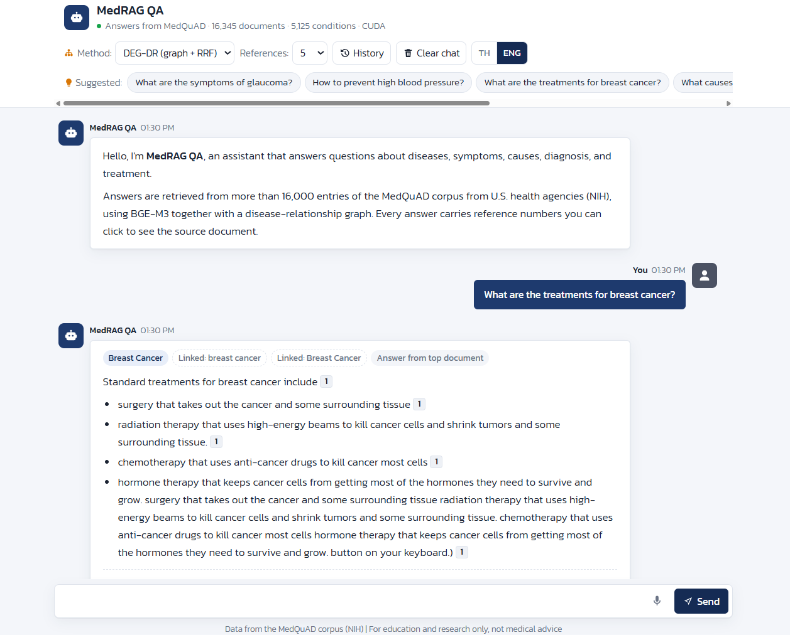

# MedRAG-QA

MedRAG-QA is an extractive medical question-answering research prototype based on MedQuAD. It retrieves medical passages using dense embeddings and label-conditioned ranking, then returns the curated answer associated with the highest-ranked document. Optional graph-neighbor expansion is evaluated separately.

## Structure

Main source files, cached artifacts, and representative result files are shown below. Additional result files and supporting documents are omitted for readability.

```text

MadRAG-QA/
|-- 01_data/
|-- 02_code/
|   |-- requirements.txt                # Python dependencies
|   |-- config.py                       # Paths and parameters
|   |-- data_prep.py                    # Data cleaning and corpus preparation
|   |-- embedder.py                     # BGE-M3 embedding wrapper
|   |-- graph_builder.py                # Entity similarity graph
|   |-- retriever.py                    # Dense search and graph/RRF fusion
|   |-- qa_pipeline.py                  # Answer generation
|   |-- metrics.py                      # Evaluation metrics
|   |-- chat.py                         # Terminal QA interface
|   |-- web_app.py                      # Flask web server and API
|   |-- web/
|   |   |-- index.html                  # Web page
|   |   |-- style.css                   # Page styles
|   |   └── app.js                      # Browser interaction
|   |-- run_experiment.py               # Main evaluation
|   |-- run_ablation.py                 # Dense-only versus graph fusion
|   |-- run_review_experiments.py       # Development and held-out evaluation
|   |-- run_sensitivity.py              # Retrieval parameter experiments
|   |-- run_chunksize_sensitivity.py    # Passage-length experiments
|   |-- run_corpus_scaling.py           # Corpus-size experiments
|   |-- run_heldout_extensions.py       # Passage-length and encoder comparisons
|   |-- run_latency.py                  # Pipeline timing
|   |-- run_scaling_latency.py          # Timing across corpus sizes
|   |-- run_web_device_latency.py       # Flask test-client CPU/GPU timing
|   |-- artifacts/
|   |   |-- corpus.parquet              # Cleaned corpus
|   |   |-- doc_embeddings.npy          # Document vectors
|   |   |-- entity_embeddings.npy       # Entity-name vectors
|   |   |-- entity_names.json           # Entity names
|   |   |-- graph.pkl                   # Saved entity graph
|   |   └── meta.json                   # Cache configuration
|   |-- artifacts_ext/                  # Passage-length and encoder caches
|   └── artifacts_scale/                # Corpus-size caches
|-- 03_result/
|   |-- result-rag.csv                  # Per-question evaluation results
|   |-- result-rag-summary.csv          # Aggregate evaluation metrics
|   |-- result-rag-comparison.csv       # Dense-only and graph comparison
|   |-- result-review-heldout.csv       # Held-out retrieval results
|   |-- result-review-paired-tests.csv  # Paired statistical comparisons
|   └── result-review-metadata.json     # Review experiment settings
|-- audit_medrag_alignment.py           # Historical audit utility
|-- consolidate_medrag.py               # Historical file-management utility
└── run_web.bat                         # Windows web launcher

```

## How It Works

1. Clean MedQuAD and index `focus_area + ". " + answer` (excluding the question field).
2. Encode passages and focus-area labels with [BGE-M3](https://huggingface.co/BAAI/bge-m3), using 1,024-dimensional dense vectors and FAISS.
3. Link queries to focus-area labels; optionally expand to one-hop neighbors in a TF-IDF similarity graph.
4. Combine dense and label-conditioned rankings using Reciprocal Rank Fusion (RRF), then return the top document's answer.

## Dataset and Configuration

The cleaned dataset contains **16,345 question–answer records** and **5,125 focus-area labels** from nine MedQuAD sources. Evaluation uses **3,349 development queries** and **12,996 held-out queries**.

| Setting | Value |
|---|---|
| Encoder | BGE-M3 (dense only) |
| FAISS | `IndexFlatIP` |
| Dense candidates / linked labels | 20 / 2 |
| Graph neighbors / threshold | 5 / 0.15 |
| RRF constant / final context | 60 / 5 |
| Indexed text limit | 3,000 characters |
| Experiment environment | Python 3.10.20, PyTorch 2.5.1, RTX 4050 6 GB |

## Retrieval Results

Results on **12,996 held-out queries** (exact-reference retrieval; MRR cutoff = 20):

| Method | Hit@1 | Hit@5 | MRR@20 |
|---|---:|---:|---:|
| BM25 | 26.45% | 71.22% | 44.65% |
| BGE-M3 dense | 68.88% | 95.04% | 80.08% |
| Dense + linked-entity RRF | 69.44% | 94.84% | 80.45% |
| Dense + entity + neighbor RRF | 69.18% | 95.16% | 80.32% |
| Dense top-20 + label bonus | 69.64% | 95.54% | 80.74% |
| Dense top-20 + BGE cross-encoder | **71.51%** | **95.92%** | **82.10%** |

Entity-only RRF improves Hit@1 over dense retrieval by **0.56 percentage points**. Neighbor expansion does not improve Hit@1 or MRR@20 over entity-only RRF. The cross-encoder is the strongest evaluated baseline; it was tested offline rather than deployed in the web interface.

## Installation and Usage

From the repository root (Windows PowerShell):

```powershell
python -m venv .venv
.\.venv\Scripts\Activate.ps1
python -m pip install -r 02_code/requirements.txt
python 02_code/web_app.py --port 5000
```

Open **http://127.0.0.1:5000**. The BGE-M3 model must be available locally or downloaded on first use. For terminal queries:

```powershell
python 02_code/chat.py --show-context --top-k 5
```

For experiments (scripts documented in the original project README):

```powershell
python 02_code/run_experiment.py
python 02_code/run_ablation.py
python 02_code/run_review_experiments.py
```

> Verify these paths against the files published in this repository. Re-running experiments may overwrite saved results or caches.


## Web Application



The Flask interface supports medical questions, retrieved evidence, and extractive answers. The optional LLM path is not part of the reported evaluation.

## Limitations

Evaluation is limited to one MedQuAD corpus with partially templated questions and unnormalized focus-area labels. TF-IDF graph edges represent lexical similarity, not verified clinical relationships. Retrieval scores do not establish clinical answer correctness or safety.

## Data and Attribution

The original dataset is available from [MedQuAD](https://github.com/abachaa/MedQuAD); the study used a publicly distributed Kaggle version. The embedding model is [BAAI/bge-m3](https://huggingface.co/BAAI/bge-m3). Cite the associated research article and dataset sources when using this work.

**Disclaimer:** Research prototype only; not intended for medical diagnosis or professional medical advice.

